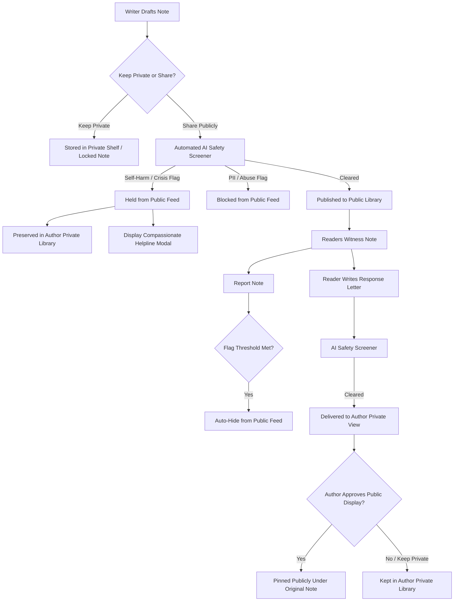
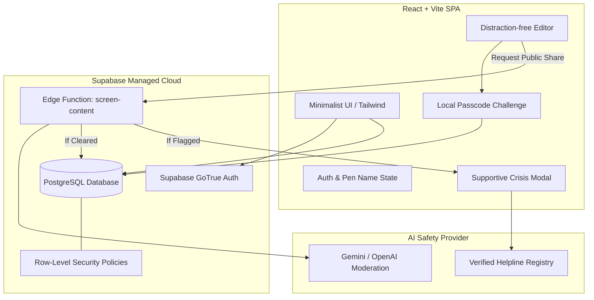

# The Library of Unsent Things

## Goal Capsule

**Objective:** Deliver an anonymous, private sanctuary where writers organize unsent thoughts across custom shelves and prompts, with the option to selectively release notes to a public community feed protected by automated AI safety screening and author-governed response letters.
**Means:** A React SPA backed by Supabase Auth, PostgreSQL with Row-Level Security, and a serverless Edge Function orchestrating automated AI safety moderation. (KTD1, KTD2, KTD3, KTD5)
**Product Authority:** The 8-week build commits exclusively to the core digital experience (private library, prompts, note locking, note-by-note public sharing, automated AI moderation with supportive hold, and threaded response letters). Surrounding capabilities—including physical print fulfillment ("year in letters"), paid newsletter infrastructure, and paid subscription processing—are explicitly deferred to post-launch.
**Open Blockers:** None.
**Execution Profile:** Standard iterative full-stack implementation across database migrations, serverless functions, and frontend components.
**Completion & Handoff:** Hand off directly to `ce-work` for unit-by-unit execution or `lfg` for autonomous end-to-end pipeline execution.

## Product Contract

### Summary
The Library of Unsent Things is an 8-week lean web application built with React and Supabase that enables writers to journal anonymously under a pen name across private custom shelves and prompts, with optional note locking. Writers can selectively publish individual unsent notes to a public community feed protected by an automated AI moderation pipeline that holds self-harm/abuse/PII with supportive helpline resources, while allowing readers to write gentle, author-approved response letters.

### Problem Frame
People carry emotionally heavy, unresolved words that they cannot speak out loud. Existing digital spaces either force public performance and risk judgment (social networks, public forums) or isolate thoughts without validation (local notes, physical diaries). Writers lack an intentional, anonymous sanctuary designed specifically for cathartic release—where private reflection can coexist with the option to be witnessed and comforted without exposing personal identity or risking toxic public commentary.

### Key Decisions
- **Core 8-week MVP boundaries:** The active scope focuses exclusively on private writing, shelves, prompts, note locking, note-by-note public sharing, automated AI moderation, and threaded response letters. (session-settled: user-directed — chosen over full monetization/printing: avoids fulfillment complexity to guarantee an 8-week launch) Governs R1, R2, R4, R9
- **Automated AI safety pipeline with Supportive Hold:** Flagged public notes for self-harm, severe distress, PII, or abuse are withheld from public view and display a compassionate helpline modal, but remain fully preserved in the author's private library. (session-settled: user-directed — chosen over hard block: ensures writers are never penalized or locked out for private venting) Governs R7, R8
- **Threaded anonymous response letters:** Public readers interact solely by writing gentle, threaded response letters rather than brief comments or likes, each screened by the same AI moderation pipeline. (session-settled: user-directed — chosen over silent reactions or read-only gallery: deepens meaningful resonance while eliminating low-effort noise) Governs R5, R6
- **Author opt-in and private-first delivery for responses:** Authors toggle response acceptance per note; responses arrive in the author's private view first and are only visible publicly if the original author approves. (session-settled: user-directed — chosen over open public threading: protects author emotional boundaries) Governs R5, R6
- **Strict database-level privacy boundary:** Supabase Row-Level Security (RLS) policies guarantee that private shelves, locked notes, and pending response letters can never be read or queried by another authenticated user or unauthenticated visitor. Governs R1, R3, R10

<!-- ce-section: work-relationships -->
### How This Work Fits Together
This plan covers the standalone 8-week digital MVP for The Library of Unsent Things. Surrounding areas represent future expansion:
- Core Digital MVP (this plan): Private shelves, locked notes, prompts, selective public sharing, automated AI safety pipeline, and author-approved response letters.
- Digital Subscription Billing (₹149/month):
  - Depends on Core Digital MVP user adoption.
  - Enables unlimited shelves, unlimited locked notes, and advanced styling.
- Physical Fulfillment ("Year in Letters" Book):
  - Depends on Core Digital MVP note history and export formats.
  - Enables automated PDF typesetting, printing partner API integration, and physical shipping.
- Curated Unsent Newsletter:
  - Depends on a pool of public notes with opt-in author syndication permissions.
  - Can proceed independently as an editorial distribution channel.

### Actors
- A1. Anonymous Writer: Signs up via email, receives an assigned or chosen pen name, writes private notes across shelves and prompts, locks notes, selectively publishes notes, and reviews incoming response letters.
- A2. Public Reader: Explores the public archive of published unsent notes, reads notes by prompt or tag, and submits response letters to notes that have responses enabled.
- A3. Automated AI Safety Screener: An automated pipeline that screens submitted public notes and response letters for self-harm language, personal identifiable information (PII), and abuse before public release.
- A4. Community Reporter: Any reader who flags a public note for moderation review if harmful content bypassed the automated screener.

### Requirements

#### Identity & Privacy
- R1. The system must authenticate writers via email while strictly dissociating the public presentation of the writer from their email address through an anonymous pen name.
- R2. The system must assign a default pseudonym upon signup while allowing the writer to customize their pen name at any time.
- R3. The database must enforce Row-Level Security (RLS) such that a writer's email address and private records can never be queried or discovered by another client.

#### Private Library & Shelves
- R4. The system must provide writers with a private library containing custom shelves to organize notes by recipient, theme, or emotional state.
- R5. The system must include a collection of guided writing prompts (e.g., "To the one who left without saying goodbye", "Things I swallowed to keep the peace") to inspire notes.
- R6. The system must allow writers to lock specific notes behind a secondary private passcode or biometric gate for eyes-only protection.

#### Public Sharing & Response Letters
- R7. The system must treat private notes as default-private, allowing publication to the public library only through an explicit, per-note sharing action.
- R8. The system must allow the author to toggle whether a publicly shared note accepts anonymous response letters.
- R9. Response letters submitted by readers must be routed to the author's private inbox first and must not appear on the public note unless the author explicitly approves them.

#### Automated Safety & Moderation
- R10. The system must automatically screen every note and response letter submitted for public release for self-harm language, severe emotional crisis, PII, and abusive content.
- R11. If a note triggers a self-harm or crisis flag, the system must hold the note from public release, preserve it safely in the author's private library, and display a supportive, localized crisis helpline modal.
- R12. The system must provide a public reporting mechanism that automatically unpublishes any public note that accumulates a configurable threshold of user flags pending review.

### Visualizations

### Key Flows

- F1. Onboarding and Anonymous Sanctuary Creation
  - **Trigger:** Writer visits the application and signs up with email.
  - **Actors:** A1 (Anonymous Writer)
  - **Steps:** Writer verifies email via magic link; system creates an encrypted user profile, assigns a unique poetic pen name, and seeds a default private library with starter prompts and shelves.
  - **Covered by:** R1, R2, R4, R5

- F2. Private Journaling and Note Locking
  - **Trigger:** Writer opens their private library to write an unsent letter.
  - **Actors:** A1 (Anonymous Writer)
  - **Steps:** Writer selects a prompt or blank note, assigns it to a shelf, writes content, and optionally toggles "Lock Note" to secure it behind secondary entry.
  - **Covered by:** R4, R5, R6

- F3. Selective Public Sharing and Safety Screening
  - **Trigger:** Writer chooses "Share to Public Library" on an existing private note.
  - **Actors:** A1 (Anonymous Writer), A3 (Automated AI Safety Screener)
  - **Steps:** Writer confirms sharing and toggles response letter permissions; system dispatches content to the AI safety screener; if cleared, the note appears on the public feed under the author's pen name; if flagged for self-harm, public release is held, the note remains in the private library, and a helpline card displays.
  - **Covered by:** R7, R8, R10, R11

- F4. Reader Response Letter Submission and Author Approval
  - **Trigger:** Reader views a public unsent note with response letters enabled and clicks "Write a Response".
  - **Actors:** A2 (Public Reader), A3 (Automated AI Safety Screener), A1 (Anonymous Writer)
  - **Steps:** Reader drafts a gentle letter under their pen name; system screens content through AI safety; upon clearance, the response letter lands in the author's private library notification queue; author reviews the letter and chooses whether to keep it private or pin it publicly under their note.
  - **Covered by:** R8, R9, R10

### Acceptance Examples

- AE1. Self-Harm Detection During Public Sharing
  - **Covers:** R10, R11
  - **Given:** An author has written an unsent note containing explicit self-harm thoughts.
  - **When:** The author clicks "Share to Public Library".
  - **Then:** The note is not published to the public library, the note remains fully intact in the author's private shelf, and a supportive modal displays active helpline phone numbers and crisis text resources.

- AE2. Database Isolation of Private Notes
  - **Covers:** R3, R7
  - **Given:** Author A has three notes marked private and one note marked public.
  - **When:** Author B or an anonymous visitor queries the Supabase REST endpoint for notes.
  - **Then:** The response returns exclusively the one public note, with Author A's private notes and email address completely excluded by database Row-Level Security.

- AE3. Author Response Approval Flow
  - **Covers:** R8, R9
  - **Given:** Author A published an unsent note with response letters enabled, and Reader B submitted an approved response letter.
  - **When:** A third visitor views the public note before Author A has reviewed the response.
  - **Then:** The public note displays zero public responses; only Author A can view Reader B's response inside Author A's private inbox until Author A toggles "Pin to Public Note".

### Success Criteria
- Zero identity leaks: Penetration check verifies that author emails can never be retrieved via client API queries, Supabase inspects, or network payload sniffing.
- Zero private note leaks: Automated RLS test suite confirms 100% rejection of unauthorized reads across private shelves and locked notes.
- Supportive safety accuracy: 100% of benchmark crisis prompts trigger the supportive helpline modal without deleting or corrupting the writer's private text.
- 8-week launch readiness: A usable, deployed web application handling complete write, share, screen, and response flows tested by waitlist journaling users within 8 weeks.

### Scope Boundaries

#### Active Scope (8-Week Build)
- Email authentication with Supabase and pen name generator/manager.
- Private library with custom shelves, prompt catalog, and locked notes.
- Note-by-note public sharing toggle.
- Automated AI screening for self-harm, PII, and abuse on public submissions.
- Compassionate helpline modal and user reporting auto-hide backstop.
- Threaded anonymous response letters with author-controlled approval and private-first delivery.

#### Deferred for Later (Post-Launch)
- Paid subscription billing (₹149/month) for unlimited shelves and locked notes.
- Physical print-on-demand fulfillment ("Year in Letters" bound book export).
- Editorial newsletter curation platform and sponsorships.
- Mobile native apps (iOS / Android) or offline PWA sync.

#### Outside This Product's Identity
- Real-time instant messaging or unvetted open public comment threads.
- Public writer profiles, follower counts, popularity leaderboards, or vanity metrics.
- Social identity login integrations (e.g., Google or Facebook public identity linking) that risk unmasking pen names.

### Dependencies / Assumptions
- Supabase Cloud provides adequate free-tier/pro-tier RLS query performance and email magic link delivery.
- OpenAI or Gemini moderation API provides rapid, automated classification of distress, self-harm, and PII.
- Helplines referenced are verified, reputable crisis resources (e.g., Vandrevala Foundation, iCall, AASRA in India, or international equivalents based on user locale).

### Outstanding Questions
- Deferred to Planning: Selection of the specific AI moderation API (Gemini Flash vs OpenAI Moderation Endpoint) and latency benchmarks for the screening step.
- Deferred to Planning: Implementation details of the secondary passcode encryption for locked notes (client-side AES vs server-side column encryption).

## Planning Contract

### Preservation and Traceability
Product Contract unchanged. Requirements R1–R12, Actors A1–A4, Flows F1–F4, and Acceptance Examples AE1–AE3 are carried forward verbatim from the confirmed brainstorm and remain normative.

### Key Technical Decisions
- KTD1. Single-Page Application (SPA) on React + Vite + Tailwind CSS: Built as a lightweight, typography-first client with zero heavyweight state management libraries, focusing on responsive layout, serene serif typography, and fast cold-start performance. Governs U1, U3, U4
- KTD2. Supabase Passwordless Magic Link Authentication: Eliminates password vulnerabilities and leaks. A PostgreSQL `AFTER INSERT ON auth.users` trigger immediately provisions a public `profiles` row with an auto-generated pseudonymous pen name, completely separating identity from credentials. (session-settled: user-directed — chosen over password auth: minimizes credential leakage risk) Governs U2, U3
- KTD3. Declarative PostgreSQL Row-Level Security (RLS) as Hard Boundary: All access control resides in database engine policies. Private notes and unapproved response letters are mathematically unqueryable by anyone other than the authenticated author; public notes are readable anonymously without bypassing filters. Governs U2, U7, U8
- KTD4. Client-Side Passcode Encryption for Locked Notes: Notes marked as locked require a local 4-6 digit passcode hash. Note bodies are stored encrypted in the database or masked in client memory until the writer authenticates locally, ensuring even accidental over-the-shoulder viewing is impossible. Governs U4, U5
- KTD5. Serverless Supabase Edge Function (`screen-content`) for AI Safety: Moderation executes in an isolated Deno runtime on Supabase Edge Functions with secret API keys. The client never talks directly to the AI provider. Prompts use structured JSON schemas to classify `self_harm_risk`, `pii_detected`, and `abusive_language`. Governs U6, U7, U8
- KTD6. Supportive Hold State Machine: When `screen-content` detects crisis or self-harm language on a shared note, the database state transitions to `status = 'held_private'`, leaving the note in the writer's private shelf while returning a structured crisis response that triggers the localized helpline modal in the UI. Governs U6, U7
- KTD7. Automated Flag Aggregation with Auto-Hide Trigger: A PostgreSQL trigger on `note_reports` counts total distinct reports per note; once `report_count >= 3`, the note's `visibility` column is automatically updated to `'hidden'`, instantly dropping it from public queries without waiting for human intervention. Governs U2, U9

### High-Level Technical Design & Architecture

#### Data Schema Architecture
The database consists of 5 dedicated tables with strict RLS enforcement:

1. `profiles`:
   - `id`: `uuid primary key references auth.users(id) on delete cascade`
   - `pen_name`: `text not null unique`
   - `created_at`: `timestamptz default now()`
   - `avatar_color`: `text default '#4A5568'`
   - *RLS:* Read public for pen names; update only by profile owner.

2. `shelves`:
   - `id`: `uuid primary key default gen_random_uuid()`
   - `user_id`: `uuid not null references profiles(id) on delete cascade`
   - `name`: `text not null`
   - `icon`: `text default 'shelf'`
   - `created_at`: `timestamptz default now()`
   - *RLS:* Full CRUD restricted to `auth.uid() = user_id`.

3. `notes`:
   - `id`: `uuid primary key default gen_random_uuid()`
   - `user_id`: `uuid not null references profiles(id) on delete cascade`
   - `shelf_id`: `uuid references shelves(id) on delete set null`
   - `title`: `text`
   - `content`: `text not null`
   - `prompt_id`: `text`
   - `is_locked`: `boolean default false`
   - `passcode_hash`: `text`
   - `is_public`: `boolean default false`
   - `allow_responses`: `boolean default false`
   - `moderation_status`: `text default 'clean' check (moderation_status in ('clean', 'held_private', 'flagged_hidden'))`
   - `report_count`: `int default 0`
   - `published_at`: `timestamptz`
   - `created_at`: `timestamptz default now()`
   - *RLS:* 
     - Select: `(auth.uid() = user_id) OR (is_public = true AND moderation_status = 'clean' AND is_locked = false)`
     - Insert/Update/Delete: `auth.uid() = user_id`

4. `response_letters`:
   - `id`: `uuid primary key default gen_random_uuid()`
   - `note_id`: `uuid not null references notes(id) on delete cascade`
   - `author_id`: `uuid not null references profiles(id) on delete cascade`
   - `content`: `text not null`
   - `is_approved_by_note_owner`: `boolean default false`
   - `moderation_status`: `text default 'clean'`
   - `created_at`: `timestamptz default now()`
   - *RLS:*
     - Select: `(auth.uid() = author_id) OR (auth.uid() IN (SELECT user_id FROM notes WHERE id = note_id)) OR (is_approved_by_note_owner = true AND moderation_status = 'clean')`
     - Insert: `auth.uid() = author_id`
     - Update: `auth.uid() IN (SELECT user_id FROM notes WHERE id = note_id)` (only original note author can approve)

5. `note_reports`:
   - `id`: `uuid primary key default gen_random_uuid()`
   - `note_id`: `uuid not null references notes(id) on delete cascade`
   - `reporter_id`: `uuid references profiles(id) on delete set null`
   - `reason`: `text not null`
   - `created_at`: `timestamptz default now()`
   - *RLS:* Insert allowed for authenticated users. Trigger updates `notes.report_count` and auto-hides if `>= 3`.

### Assumptions & Implementation Constraints
- Vite React client uses `@supabase/supabase-js` v2 for realtime session handling and Postgres subscriptions.
- The AI moderation Edge Function uses a fallback: if the AI provider returns a 500 or times out after 4 seconds, the note remains in `held_private` state with a retry option to prevent unvetted public publishing.
- Verified helpline data is packaged in a static JSON directory (`src/data/helplines.json`) categorized by country and region, with verified phone numbers, SMS text lines, and online chat URLs.

## Implementation Units

### U1. Project Initialization, Build Tooling & Supabase Client Setup
- **Goal:** Set up a clean, modern Vite React application with Tailwind CSS, Lucide icons, testing scaffolding (Vitest), and Supabase SDK integration.
- **Requirements Covered:** R1, R3
- **Dependencies:** None
- **Files to Create / Modify:**
  - `package.json`: Dependencies for React, Tailwind, Supabase JS client, Vitest.
  - `vite.config.ts`: Vite build configuration.
  - `tailwind.config.js`: Typography and custom serene color palette configuration.
  - `src/lib/supabase.ts`: Supabase client initialization with environment variables.
  - `src/types/database.ts`: TypeScript type definitions matching Supabase schema.
  - `.env.example`: Template for Supabase URL and Anon key.
- **Approach & Technical Guidance:**
  - Initialize Vite with React + TypeScript template.
  - Install `@supabase/supabase-js`, `lucide-react`, and `@tailwindcss/typography`.
  - Configure Vitest for fast, headless component and utility unit testing.
- **Test Scenarios:**
  - TS1.1: Verify `src/lib/supabase.ts` throws a descriptive error if environment variables are missing.
  - TS1.2: Verify Vite build completes with zero TypeScript or lint errors.
- **Verification:** Run `npm run build` and `npm run test` successfully.

### U2. Database Schema, Migration Scripts & Row-Level Security (RLS) Policies
- **Goal:** Author the complete PostgreSQL schema migrations, indexes, triggers, and comprehensive Row-Level Security policies.
- **Requirements Covered:** R1, R2, R3, R7, R8, R9, R10, R11, R12
- **Dependencies:** U1
- **Files to Create / Modify:**
  - `supabase/migrations/20261016_initial_schema.sql`: DDL for all 5 tables (`profiles`, `shelves`, `notes`, `response_letters`, `note_reports`).
  - `supabase/migrations/20261016_rls_policies.sql`: RLS rules for table isolation and security boundaries.
  - `supabase/migrations/20261016_triggers.sql`: Auto-profile provisioning on signup and report threshold auto-hide trigger.
  - `supabase/seed.sql`: Initial seed data including curated writing prompts.
- **Approach & Technical Guidance:**
  - Implement strict RLS: explicitly enable `ROW LEVEL SECURITY` on every table.
  - Create the `handle_new_user()` trigger on `auth.users` that automatically inserts a unique pen name into `profiles`.
  - Create the `check_report_threshold()` trigger on `note_reports` to set `notes.moderation_status = 'flagged_hidden'` when `report_count >= 3`.
- **Test Scenarios:**
  - TS2.1: Verify inserting a new row into `auth.users` creates a corresponding row in `profiles` with a populated pen name.
  - TS2.2: Verify querying `notes` as User B cannot read any row where `user_id = User A` and `is_public = false`.
  - TS2.3: Verify an anonymous client querying `profiles` cannot select or filter on the internal user email address.
- **Verification:** Execute SQL migration script against Supabase local emulator and confirm clean table creation.

### U3. Anonymous Pen Name Identity & Magic Link Authentication
- **Goal:** Implement the passwordless email magic-link sign-in experience, session state provider, and pen name display/customization component.
- **Requirements Covered:** R1, R2
- **Dependencies:** U1, U2
- **Files to Create / Modify:**
  - `src/contexts/AuthContext.tsx`: React context managing Supabase session, auth status, and current pen name profile.
  - `src/components/auth/SignInModal.tsx`: Email input modal sending Supabase magic link with supportive copy.
  - `src/components/auth/PenNameBadge.tsx`: Header badge displaying current pen name with edit modal.
  - `src/utils/pseudonyms.ts`: Generative list of poetic, anonymous pen names (e.g., "Wandering Quill", "Midnight Echo", "Paper Lantern").
- **Approach & Technical Guidance:**
  - Wrap application in `AuthProvider`.
  - Listen to `supabase.auth.onAuthStateChange` to sync profile and pen name state.
  - Pen name customization validates uniqueness in the `profiles` table.
- **Test Scenarios:**
  - TS3.1: Submitting a valid email triggers `supabase.auth.signInWithOtp` and displays a "Check your email for your magic link" confirmation view.
  - TS3.2: Updating pen name successfully writes to `profiles.pen_name` and updates the application header immediately.
- **Verification:** Unit tests for `AuthContext` and component render tests for `PenNameBadge`.

### U4. Private Library, Custom Shelves & Prompt Catalog Engine
- **Goal:** Build the writer's private workspace featuring custom shelf management, prompt selection, and a distraction-free note editor.
- **Requirements Covered:** R4, R5
- **Dependencies:** U2, U3
- **Files to Create / Modify:**
  - `src/pages/LibraryPage.tsx`: Primary private library view showing shelves and note list.
  - `src/components/library/ShelfManager.tsx`: Modal to create, rename, and organize shelves.
  - `src/components/library/PromptSelector.tsx`: Carousel/grid of evocative writing prompts.
  - `src/components/editor/NoteEditor.tsx`: Distraction-free writing surface with auto-save and shelf assignment.
  - `src/data/prompts.json`: Curated catalog of prompts (e.g., "To the version of me I left behind", "The unspoken apology").
- **Approach & Technical Guidance:**
  - Shelves list displays custom folders (e.g., "Unspoken Love", "Family Ghosts", "Things I Regret").
  - Auto-save debounces writes to `notes` table every 1500ms.
  - Clean typographic design with serif fonts and subtle calming colors.
- **Test Scenarios:**
  - TS4.1: Creating a shelf named "Childhood" persists to `shelves` table and appears in the sidebar.
  - TS4.2: Selecting a prompt populates the note's `prompt_id` and initial header text in `NoteEditor`.
- **Verification:** Component test verifying note auto-save state updates and shelf filtering.

### U5. Client-Side Note Passcode Locking & Masked State Management
- **Goal:** Implement the secondary eyes-only privacy gate allowing writers to lock specific notes behind a secret PIN passcode.
- **Requirements Covered:** R6
- **Dependencies:** U4
- **Files to Create / Modify:**
  - `src/components/editor/LockNoteToggle.tsx`: Toggle control in the editor to enable note locking.
  - `src/components/library/PasscodeModal.tsx`: Numeric keypad PIN entry dialog.
  - `src/utils/crypto.ts`: Utility for generating and verifying salted SHA-256 passcode hashes.
  - `src/components/library/NoteCard.tsx`: Card component in library listing; renders masked blur state when locked.
- **Approach & Technical Guidance:**
  - When a note is locked (`is_locked = true`), the note card in the library list displays a padlock icon and blurred excerpt placeholder.
  - Clicking a locked note triggers `PasscodeModal`. Upon correct PIN verification, the note unlocks in local component memory for the current session.
  - Passcode hash is verified locally before rendering the plaintext content.
- **Test Scenarios:**
  - TS5.1: A locked note renders masked preview text and cannot be opened without passing PIN verification.
  - TS5.2: Entering an incorrect PIN displays a gentle "Incorrect passcode" message and leaves content masked.
- **Verification:** Unit tests for `crypto.ts` hash verification and component test for `PasscodeModal`.

### U6. Serverless AI Moderation Edge Function & Supportive Helpline Modal
- **Goal:** Implement the Supabase Edge Function (`screen-content`) that evaluates public submissions and the compassionate UI helpline modal.
- **Requirements Covered:** R10, R11
- **Dependencies:** U1, U2
- **Files to Create / Modify:**
  - `supabase/functions/screen-content/index.ts`: Edge function calling Gemini/OpenAI moderation API.
  - `src/components/safety/HelplineModal.tsx`: Empathetic modal presenting crisis resources when self-harm is detected.
  - `src/data/helplines.json`: Directory of vetted global and regional helplines (phone numbers, text lines).
  - `src/services/moderation.ts`: Client service invoking the `screen-content` Edge Function.
- **Approach & Technical Guidance:**
  - Edge function parses note text and checks for:
    1. Active self-harm / suicide intent.
    2. Explicit personally identifiable information (phone numbers, full names, home addresses).
    3. Severe harassment or hate speech.
  - If self-harm is detected, the function updates note `moderation_status = 'held_private'`, returns `{ status: 'held', reason: 'self_harm' }`.
  - The client displays `HelplineModal` with compassionate, non-judgmental wording and verified crisis contacts.
- **Test Scenarios:**
  - TS6.1: Submitting text with self-harm phrases to `screen-content` returns `status: 'held'` and does not update note to `is_public = true`.
  - TS6.2: When `HelplineModal` triggers, it renders active helpline numbers and a clear reassurance that the note is safely preserved in the writer's private library.
- **Verification:** Unit tests with mock moderation responses verifying helpline trigger logic.

### U7. Note-by-Note Public Sharing Pipeline & Community Reading Feed
- **Goal:** Implement the public library reading feed where anonymous notes are discovered and read, with prompt filtering and search.
- **Requirements Covered:** R7, R8, R10
- **Dependencies:** U4, U6
- **Files to Create / Modify:**
  - `src/pages/PublicFeedPage.tsx`: Public feed view displaying cleared unsent notes.
  - `src/components/library/ShareModal.tsx`: Dialog where author confirms sharing and toggles "Allow response letters".
  - `src/components/feed/PublicNoteCard.tsx`: Public letter display card showing pen name, date, prompt, and letter text.
  - `src/components/feed/FeedFilter.tsx`: Filter tabs (Recent, By Prompt, Most Resonated).
- **Approach & Technical Guidance:**
  - Public notes query uses Supabase client with filters: `is_public.eq.true`, `moderation_status.eq.clean`.
  - Share modal invokes `screen-content` first. If clean, sets `is_public = true` and `allow_responses = true/false`.
  - Reading feed renders notes with beautiful card styling and respectful spacing.
- **Test Scenarios:**
  - TS7.1: A note marked `is_public = true` immediately appears on `PublicFeedPage` under the author's pen name with no email visible.
  - TS7.2: Unpublishing a note sets `is_public = false`, immediately removing it from the public feed.
- **Verification:** End-to-end component test verifying the share-to-feed publication flow.

### U8. Threaded Anonymous Response Letters & Author Approval Dashboard
- **Goal:** Enable public readers to write gentle response letters, and provide authors with a private dashboard to review and pin them.
- **Requirements Covered:** R8, R9, R10
- **Dependencies:** U6, U7
- **Files to Create / Modify:**
  - `src/components/feed/ResponseComposer.tsx`: Letter writing modal for readers to reply to an unsent note.
  - `src/components/library/AuthorInbox.tsx`: Author view showing pending incoming response letters.
  - `src/components/feed/ThreadedResponses.tsx`: Section below public note showing approved pinned response letters.
- **Approach & Technical Guidance:**
  - Response composer checks `allow_responses` on target note before rendering.
  - Submitted response is screened by `screen-content` Edge Function; if clean, inserted into `response_letters` with `is_approved_by_note_owner = false`.
  - Author receives a notification badge in their private library.
  - Inside `AuthorInbox`, the author can click "Pin to Public Note" (`is_approved_by_note_owner = true`) or "Keep Private in My Library".
- **Test Scenarios:**
  - TS8.1: A reader submitting a response letter creates a record in `response_letters` that is invisible on the public note feed until approved.
  - TS8.2: When the note author approves the letter, it immediately becomes visible to all readers under `ThreadedResponses`.
- **Verification:** Integration test verifying response letter lifecycle from draft -> screening -> author approval -> public display.

### U9. Community Reporting & Automatic Threshold Auto-Hide Engine
- **Goal:** Implement the community reporting backstop allowing readers to report harmful content with automatic unpublishing at threshold.
- **Requirements Covered:** R12
- **Dependencies:** U2, U7
- **Files to Create / Modify:**
  - `src/components/feed/ReportModal.tsx`: Dialog allowing readers to select report reason (Harassment, Personal Info, Explicit Harm).
  - `src/services/reporting.ts`: Service submitting report to `note_reports` table.
- **Approach & Technical Guidance:**
  - Report button is available on every public note and response letter.
  - Report submission inserts into `note_reports`.
  - The database trigger increments `notes.report_count`. If count reaches 3, `moderation_status` switches to `'flagged_hidden'`, and RLS immediately prevents public reads.
- **Test Scenarios:**
  - TS9.1: Submitting 3 reports from distinct accounts against a public note triggers the auto-hide policy, removing the note from public queries.
- **Verification:** Database test verifying the `check_report_threshold` trigger function.

### U10. End-to-End Privacy Verification Suite & Deployment Configuration
- **Goal:** Build the comprehensive privacy verification test suite and configure production deployment settings.
- **Requirements Covered:** R1, R2, R3, R7, R11
- **Dependencies:** U1 through U9
- **Files to Create / Modify:**
  - `tests/rls-security.test.ts`: Automated test suite attempting cross-account unauthorized reads and writes.
  - `tests/moderation-benchmark.test.ts`: Benchmark test suite validating safety classification against test phrases.
  - `vercel.json` / `netlify.toml`: Deployment and routing redirect configuration for SPA.
  - `README.md`: Setup instructions for local development and Supabase deployment.
- **Approach & Technical Guidance:**
  - Test suite simulates two distinct authenticated Supabase clients (User A and User B) and an unauthenticated client.
  - Validates that User B cannot read User A's private shelves, private notes, locked notes, or pending response letters under any query parameters.
- **Test Scenarios:**
  - TS10.1: Security suite confirms 100% rejection rate for cross-tenant private data queries.
  - TS10.2: Production build generates optimized static bundles without environment credential leaks.
- **Verification:** Execute `npm test` and verify all security and unit tests pass.

## Verification Contract

### Automated Verification Gates
- **Typecheck & Lint:** `npm run typecheck && npm run lint` must exit with 0 errors.
- **Component & Unit Suite:** `npm run test` executes Vitest across all component and utility test suites.
- **RLS Security Test Suite:** `npm run test:security` validates that database policies block all unauthorized cross-tenant data requests.
- **AI Moderation Benchmark:** `npm run test:moderation` validates that simulated self-harm and distress strings consistently trigger the supportive hold flow.

### Manual Walkthrough Verification
1. **Onboarding & Pseudonymity:** Sign up via email magic link, confirm automatic pen name assignment, verify that the email is nowhere visible in the browser DOM or local state.
2. **Private Journaling & Locking:** Create a custom shelf, draft a note from a prompt, lock the note with a PIN, verify the note displays masked in the library and unlocks upon PIN entry.
3. **Public Sharing & Self-Harm Safety:** Attempt sharing a note with explicit crisis language; verify that the note is held from the public feed, preserved in the private library, and that the compassionate helpline modal opens.
4. **Clean Public Release & Response Letters:** Share a benign poetic note, verify it appears on the public feed; as a second user, submit a response letter; verify the letter appears in the author's private inbox first and only appears publicly after author approval.
5. **Community Reporting Auto-Hide:** Submit 3 reports on a test note; verify the note immediately vanishes from the public feed.

## Definition of Done

### Global Criteria
- All 10 Implementation Units are complete with corresponding code, components, and tests.
- Supabase Row-Level Security is enabled and verified on all 5 tables (`profiles`, `shelves`, `notes`, `response_letters`, `note_reports`).
- Zero instances of user email addresses exposed to public queries or frontend state.
- Automated AI safety pipeline reliably diverts crisis notes into the supportive hold workflow.
- Clean code standard: No lingering debug logs, test credentials, or unreferenced assets in the repository.
- Complete documentation in `README.md` explaining environment variable setup, migration steps, and local testing.
